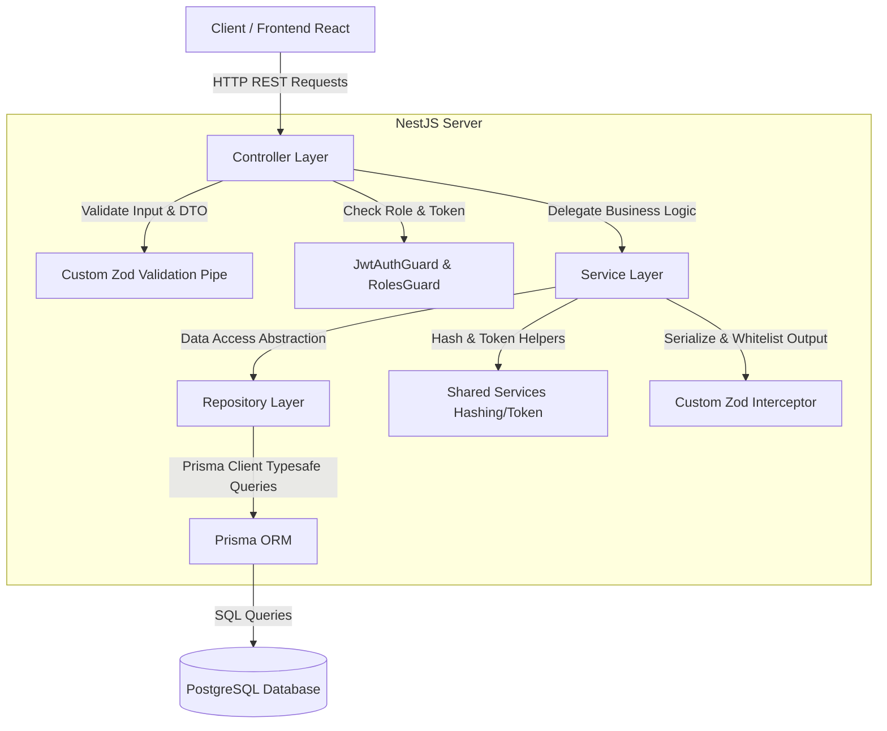
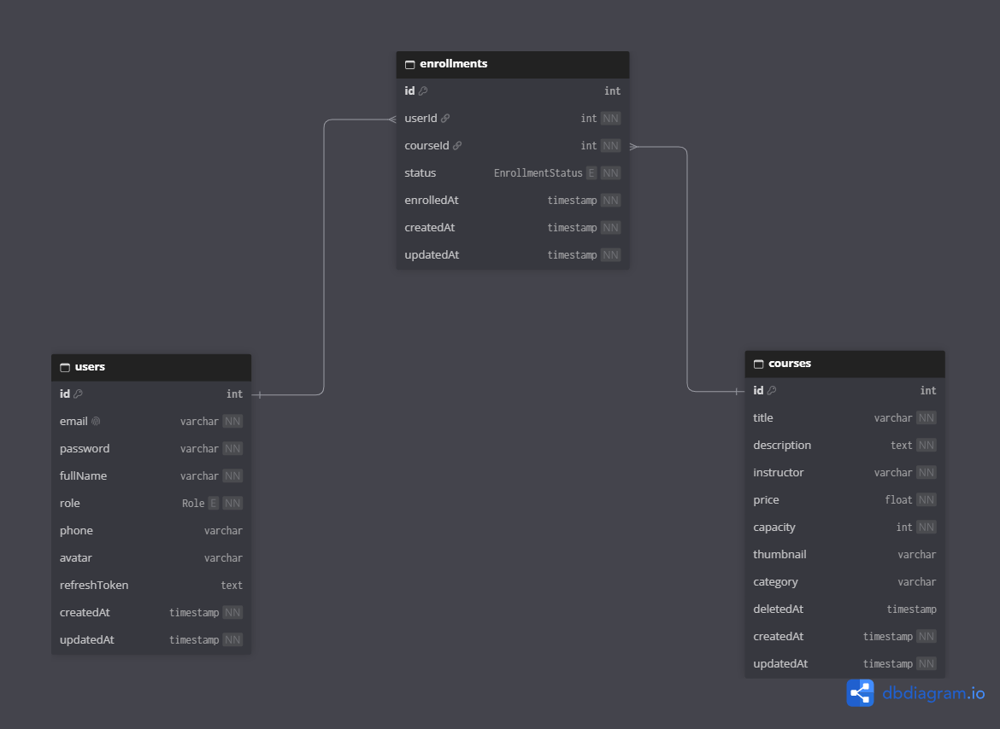

<div align="center">

# 🎓 EduPro — Enterprise Course Management & Enrollment System
### Hệ Thống Quản Lý Đào Tạo & Ghi Danh Khóa Học Trực Tuyến Hiện Đại

[](https://nestjs.com/)
[](https://react.dev/)
[](https://www.typescriptlang.org/)
[](https://www.prisma.io/)
[](https://www.postgresql.org/)
[](https://vitejs.dev/)
[](https://jestjs.io/)
[](LICENSE)

<br/>

> **EduPro** là giải pháp nền tảng quản lý khóa học và ghi danh trực tuyến toàn diện, được thiết kế theo tiêu chuẩn công nghiệp (**Enterprise-Grade**) với kiến trúc phân tầng rõ ràng (**Clean Architecture**), kiểm soát dữ liệu chặt chẽ bằng **Zod**, bảo mật xác thực hai lớp **JWT (Access & Silent Refresh Token)**, phân quyền **RBAC** và giao diện người dùng **Glassmorphism** sang trọng.

</div>

---

## 📑 Mục lục
1. [Tính năng cốt lõi (Key Features)](#-tính-năng-cốt-lõi-key-features)
2. [Ngăn xếp công nghệ (Tech Stack)](#-ngăn-xếp-công-nghệ-tech-stack)
3. [Kiến trúc hệ thống (Architecture)](#-kiến-trúc-hệ-thống-architecture)
4. [Thiết kế Cơ sở dữ liệu (ERD)](#-thiết-kế-cơ-sở-dữ-liệu-erd)
5. [Cấu trúc thư mục (Project Structure)](#-cấu-trúc-thư-mục-project-structure)
6. [Hướng dẫn cài đặt & Chạy ứng dụng (Quick Start)](#-hướng-dẫn-cài-đặt--chạy-ứng-dụng-quick-start)
7. [Tài khoản thử nghiệm mặc định (Demo Credentials)](#-tài-khoản-thử-nghiệm-mặc-định-demo-credentials)
8. [Tài liệu API & Postman Collection](#-tài-liệu-api--postman-collection)
9. [Kiểm thử tự động (Automated Testing)](#-kiểm-thử-tự-động-automated-testing)
10. [Giấy phép (License)](#-giấy-phép-license)

---

## 🌟 Tính năng cốt lõi (Key Features)

### 🔐 1. Xác thực & Bảo mật (Authentication & Authorization)
- **Chuẩn xác thực kép**: Cấp phát `accessToken` (ngắn hạn: 15 phút) và `refreshToken` (dài hạn: 7 ngày) được mã hóa một chiều trong Database.
- **Silent Token Refresh**: Frontend tự động làm mới Access Token trong nền khi gặp mã HTTP `401 Unauthorized` mà không làm gián đoạn tác vụ của người dùng.
- **Mã hóa mật khẩu**: Sử dụng thuật toán `bcryptjs` với độ muối an toàn (`salt rounds = 10`).
- **Phân quyền vai trò (RBAC)**: Tách biệt quyền hạn giữa **Quản trị viên (`ADMIN`)** và **Học viên (`STUDENT`)** thông qua Custom Decorator `@Roles()` và NestJS `RolesGuard`.

### 📚 2. Quản lý Khóa học (Course Management)
- **Duyệt & Tìm kiếm thời gian thực**: Tìm kiếm toàn văn theo từ khóa (`q`) trên tên, mô tả, giảng viên và lọc theo danh mục (`category`).
- **Tính toán chỗ trống tự động**: Hệ thống tự động tính toán `enrolledCount` (số lượng đã ghi danh), `availableSpots` (số chỗ còn trống), và cờ cảnh báo `isFull`.
- **Cá nhân hóa trạng thái**: Trả về thuộc tính `isUserEnrolled: true/false` khi người dùng đã đăng nhập xem chi tiết khóa học.
- **Xóa mềm (Soft Delete)**: Khi quản trị viên xóa khóa học, hệ thống cập nhật trường `deletedAt` mà không xóa vật lý khỏi Database, giúp bảo toàn toàn vẹn lịch sử ghi danh của học viên.

### 📝 3. Nghiệp vụ Ghi danh (Enrollment Engine)
- **Kiểm soát trùng lặp**: Nghiêm cấm học viên ghi danh lặp lại cùng một khóa học (Ràng buộc duy nhất cấp ứng dụng và Database `UNIQUE(userId, courseId)`).
- **Kiểm soát sĩ số tối đa (Capacity Guard)**: Từ chối đăng ký và trả về HTTP `400 Bad Request` khi lớp học đã đạt sĩ số tối đa.
- **Quản lý khóa học của tôi**: Học viên dễ dàng theo dõi tiến độ các khóa học đang tham gia.
- **Hủy ghi danh an toàn**: Học viên có thể chủ động hủy đăng ký (chuyển trạng thái sang `CANCELLED`).

### 💎 4. Giao diện Người dùng Đỉnh cao (Premium UI/UX)
- Thiết kế theo phong cách **Glassmorphism** hiện đại kết hợp bảng màu sắc nét, độ tương phản cao.
- Hiệu ứng chuyển động vi mô (Micro-animations), hiển thị trạng thái tải và thông báo dạng Toast tương tác mượt mà.
- Khả năng hiển thị tối ưu trên mọi kích thước màn hình (**Responsive 100% Mobile, Tablet, Desktop**).

---

## 🛠 Ngăn xếp công nghệ (Tech Stack)

| Phân hệ | Công nghệ | Phiên bản | Vai trò & Mục đích sử dụng |
| :--- | :--- | :---: | :--- |
| **Backend Framework** | [NestJS](https://nestjs.com/) | `v11.0` | Khung ứng dụng máy chủ Node.js kiến trúc module hóa mạnh mẽ |
| **Language** | [TypeScript](https://www.typescriptlang.org/) | `v5.7` | Ngôn ngữ tĩnh giúp kiểm soát kiểu dữ liệu nghiêm ngặt toàn dự án |
| **Database ORM** | [Prisma](https://www.prisma.io/) | `v7.10` | ORM thế hệ mới truy vấn PostgreSQL an toàn, tự động sinh type |
| **Database Engine** | [PostgreSQL](https://www.postgresql.org/) | `v16+` | Hệ quản trị cơ sở dữ liệu quan hệ mạnh mẽ, chuẩn ACID |
| **Data Validation** | [Zod](https://zod.dev/) | `v3.24` | Định nghĩa Schema & Validate dữ liệu 2 đầu (Request DTO & Response Filter) |
| **Security & Auth** | [Passport JWT](http://www.passportjs.org/) + [Bcrypt](https://github.com/dcodeIO/bcrypt.js) | — | Bảo mật phân quyền, cấp phát Token và băm mật khẩu |
| **Frontend Core** | [React](https://react.dev/) + [Vite](https://vitejs.dev/) | `React 19 / Vite 8` | Thư viện UI hiện đại kết hợp trình đóng gói siêu tốc |
| **Icons & Styling** | [Lucide React](https://lucide.dev/) + Vanilla CSS | — | Bộ biểu tượng tinh tế và hệ thống Design Token CSS linh hoạt |
| **Testing** | [Jest](https://jestjs.io/) | `v30.0` | Khung kiểm thử tự động toàn diện Unit Tests |

---

## 🏛 Kiến trúc hệ thống (Architecture)

Dự án áp dụng mô hình **Clean Architecture / N-Tier Architecture** tách biệt hoàn toàn trách nhiệm giữa các tầng:



---

## 🗄 Thiết kế Cơ sở dữ liệu (ERD)

Sơ đồ quan hệ thực thể được thiết kế tối ưu, có khóa ngoại và ràng buộc toàn vẹn:



### Mã mô hình DBML (Database Markup Language)
```dbml
Enum Role {
  STUDENT
  ADMIN
}

Enum EnrollmentStatus {
  ENROLLED
  CANCELLED
}

Table users {
  id int [pk, increment]
  email varchar [unique, not null]
  password varchar [not null]
  fullName varchar [not null]
  role Role [default: 'STUDENT', not null]
  phone varchar
  avatar varchar
  refreshToken text
  createdAt timestamp [default: `now()`, not null]
  updatedAt timestamp [not null]
}

Table courses {
  id int [pk, increment]
  title varchar [not null]
  description text [not null]
  instructor varchar [not null]
  price float [default: 0, not null]
  capacity int [default: 30, not null]
  thumbnail varchar
  category varchar [default: 'Lập trình']
  deletedAt timestamp [note: 'Soft delete flag']
  createdAt timestamp [default: `now()`, not null]
  updatedAt timestamp [not null]
}

Table enrollments {
  id int [pk, increment]
  userId int [not null]
  courseId int [not null]
  status EnrollmentStatus [default: 'ENROLLED', not null]
  enrolledAt timestamp [default: `now()`, not null]
  createdAt timestamp [default: `now()`, not null]
  updatedAt timestamp [not null]

  indexes {
    (userId, courseId) [unique]
  }
}

Ref: enrollments.userId > users.id [delete: cascade]
Ref: enrollments.courseId > courses.id [delete: cascade]
```

---

## 📂 Cấu trúc thư mục (Project Structure)

```plaintext
course-management/
├── backend/                              # Mã nguồn máy chủ NestJS
│   ├── prisma/
│   │   ├── schema.prisma                 # Định nghĩa Database Models & Relations
│   │   └── prisma7.config.ts             # Cấu hình Prisma v7
│   ├── src/
│   │   ├── database/
│   │   │   └── seed.ts                   # Kịch bản nạp dữ liệu mẫu ban đầu
│   │   ├── routes/
│   │   │   ├── auth/                     # Module Xác thực (Register, Login, Refresh, Logout)
│   │   │   ├── courses/                  # Module Quản lý Khóa học (CRUD, Soft Delete)
│   │   │   └── enrollments/              # Module Nghiệp vụ Ghi danh (Enroll, Cancel, My-Courses)
│   │   ├── shared/                       # Các thành phần tái sử dụng (Guards, Pipes, Filters, Services)
│   │   └── main.ts                       # Entrypoint khởi động NestJS Application
│   ├── .env.example                      # Mẫu biến môi trường cho Backend
│   └── package.json
│
├── frontend/                             # Mã nguồn ứng dụng giao diện React + Vite
│   ├── src/
│   │   ├── api/
│   │   │   └── client.ts                 # Fetch API Client kèm cơ chế Silent Refresh Token
│   │   ├── components/                   # Các UI Components dùng chung (Header, Footer, Toast, Guards)
│   │   ├── context/                      # Quản lý trạng thái xác thực người dùng (AuthContext)
│   │   ├── pages/                        # Các trang chính (HomePage, CourseDetailPage, LoginPage,...)
│   │   ├── types/                        # Khai báo TypeScript Interfaces & Types
│   │   ├── index.css                     # Design System & Token Styles
│   │   └── App.tsx                       # Cấu hình Router và Bố cục ứng dụng
│   ├── .env.example                      # Mẫu biến môi trường cho Frontend
│   └── package.json
│
├── docs/                                 # Tài liệu kiểm thử, thiết kế & Postman
│   ├── ERD.png                           # Ảnh chụp sơ đồ thực thể cơ sở dữ liệu
│   └── course_management.postman_collection.json # Bộ sưu tập Postman Collection đầy đủ
├── .gitignore                            # Cấu hình loại trừ Git tiêu chuẩn
└── README.md                             # Tài liệu dự án (Tài liệu này)
```

---

## 🚀 Hướng dẫn cài đặt & Chạy ứng dụng (Quick Start)

### 1. Yêu cầu tiên quyết (Prerequisites)
* **Node.js**: Phiên bản `v18.x` hoặc `v20.x+`
* **PostgreSQL**: Phiên bản `14+` đang hoạt động (Local hoặc Docker)

---

### 2. Cài đặt và khởi chạy Backend (NestJS)

```bash
# 1. Di chuyển vào thư mục backend
cd backend

# 2. Cài đặt các thư viện phụ thuộc
npm install

# 3. Tạo file cấu hình môi trường từ mẫu
cp .env.example .env
# Chỉnh sửa chuỗi DATABASE_URL trong .env phù hợp với tài khoản PostgreSQL của bạn

# 4. Sinh Prisma Client và đồng bộ cấu trúc Database
npx prisma generate
npx prisma db push

# 5. Nạp dữ liệu mẫu ban đầu (Tài khoản mẫu, khóa học mẫu)
npm run seed

# 6. Khởi động máy chủ phát triển
npm run start:dev
```
> Máy chủ Backend sẽ hoạt động tại: **`http://localhost:5000/api`**

---

### 3. Cài đặt và khởi chạy Frontend (React + Vite)

Mở một cửa sổ Terminal mới:

```bash
# 1. Di chuyển vào thư mục frontend
cd frontend

# 2. Cài đặt các thư viện phụ thuộc
npm install

# 3. Khởi động giao diện người dùng
npm run dev
```
> Ứng dụng Web sẽ hoạt động tại: **`http://localhost:5173`**

---

## 🔑 Tài khoản thử nghiệm mặc định (Demo Credentials)

Sau khi chạy lệnh `npm run seed`, hệ thống đã chuẩn bị sẵn các tài khoản sau để bạn đăng nhập thử nghiệm:

| Vai trò | Email đăng nhập | Mật khẩu mặc định | Quyền hạn trong hệ thống |
| :--- | :--- | :--- | :--- |
| **Quản trị viên (`ADMIN`)** | `admin@course.vn` | `Password123!` | Xem, **Tạo mới**, **Cập nhật**, **Xóa mềm** khóa học & Xem danh sách học viên |
| **Học viên (`STUDENT`)** | `student@course.vn` | `Password123!` | Xem khóa học, **Ghi danh khóa học**, Xem danh sách khóa học của tôi, Hủy đăng ký |
| **Học viên 2 (`STUDENT`)** | `student2@course.vn` | `Password123!` | Tài khoản học viên phụ để kiểm thử tranh chấp sĩ số |

---

## 📡 Tài liệu API & Postman Collection

Toàn bộ các API được đóng gói sẵn trong file Postman Collection:
👉 **[`docs/course_management.postman_collection.json`](docs/course_management.postman_collection.json)**

### Cách sử dụng trên Postman:
1. Mở phần mềm **Postman**.
2. Nhấn nút **Import** ở góc trên bên trái -> Chọn file `docs/course_management.postman_collection.json`.
3. Bộ sưu tập sẽ tự động thiết lập biến `{{baseUrl}} = http://localhost:5000/api`.
4. Khi chạy request **Login (Admin hoặc Student)**, Postman Test Script sẽ **tự động lưu `adminToken` / `studentToken`** vào biến môi trường để bạn gọi các API tiếp theo mà không cần copy token thủ công!

### Tóm tắt các Endpoints chính:

| Module | Phương thức | Đường dẫn API | Quyền hạn | Mô tả chức năng |
| :--- | :---: | :--- | :---: | :--- |
| **Auth** | `POST` | `/api/auth/register` | Public | Đăng ký tài khoản học viên mới |
| **Auth** | `POST` | `/api/auth/login` | Public | Đăng nhập nhận `accessToken` & `refreshToken` |
| **Auth** | `POST` | `/api/auth/refresh` | Public | Tự động làm mới cặp token khi hết hạn |
| **Auth** | `GET` | `/api/auth/profile` | Logged In | Lấy thông tin cá nhân của tài khoản hiện tại |
| **Auth** | `POST` | `/api/auth/logout` | Logged In | Đăng xuất và hủy Refresh Token trong DB |
| **Courses** | `GET` | `/api/courses` | Public | Lấy danh sách khóa học (hỗ trợ tìm kiếm `q`, `category`) |
| **Courses** | `GET` | `/api/courses/:id` | Public/Auth | Xem chi tiết khóa học & trạng thái đã ghi danh |
| **Courses** | `POST` | `/api/courses` | `ADMIN` | Tạo khóa học mới |
| **Courses** | `PUT` | `/api/courses/:id` | `ADMIN` | Cập nhật thông tin khóa học |
| **Courses** | `DELETE` | `/api/courses/:id` | `ADMIN` | **Xóa mềm (Soft Delete)** khóa học |
| **Courses** | `GET` | `/api/courses/:id/enrollments`| `ADMIN` | Xem danh sách học viên đã ghi danh vào khóa |
| **Enrollments** | `POST` | `/api/enrollments` | `STUDENT` | Ghi danh vào lớp học (Kiểm tra sĩ số & trùng lặp) |
| **Enrollments** | `GET` | `/api/enrollments/my-courses` | `STUDENT` | Lấy danh sách các khóa học đã ghi danh của tôi |
| **Enrollments** | `DELETE`| `/api/enrollments/course/:id` | `STUDENT` | Hủy ghi danh khóa học |

---

## 🧪 Kiểm thử tự động (Automated Testing)

Dự án được bảo vệ nghiêm ngặt bằng hệ thống Unit Test trên **Jest**:

```bash
# Chạy Unit Tests ở Backend
cd backend
npm run test
```

### Kết quả kiểm thử thực tế:
```bash
PASS src/routes/auth/auth.service.spec.ts
PASS src/routes/courses/courses.service.spec.ts
PASS src/routes/enrollments/enrollments.service.spec.ts

Test Suites: 3 passed, 3 total
Tests:       20 passed, 20 total
Snapshots:   0 total
Time:        1.844 s
Ran all test suites.
```
> Toàn bộ **20/20 test cases** kiểm tra nghiệp vụ cốt lõi (Xác thực, CRUD khóa học, Xóa mềm, Giới hạn sĩ số, Chống trùng lặp ghi danh) đều đạt trạng thái **PASS (100%)**.

---

## 📄 Giấy phép (License)

Dự án được phân phối dưới giấy phép **MIT License**. Bạn hoàn toàn có thể tự do sử dụng, chỉnh sửa và triển khai cho các mục đích học tập cũng như thương mại.

---

<div align="center">
  <b>Developed with ❤️ for Enterprise Education Management.</b>
</div>
